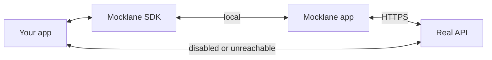

# Mocklane SDK

The SDK works with the **Mocklane app** to capture your app's HTTP traffic in debug builds, on Android (Kotlin), iOS (Swift), Flutter (Dart), and the web (JavaScript). Every request and response appears in the Mocklane app's Traffic view, where you can inspect, mock, rewrite, and debug them.



You do not need to install a certificate, configure a proxy, or add a pinning exception. The SDK rewrites the request URL before the HTTP client opens a connection, so the intercepted request goes to the loopback gateway over plain HTTP and the Mocklane app makes the upstream HTTPS request.

The SDK does not intercept traffic unless `enabled` is `true`. Every integration passes a debug-only build flag explicitly, so release builds cannot capture by accident.

## Quick start

### Android / JVM — Kotlin (JDK 17)

The SDK supports OkHttp (including Retrofit) and Ktor. The artifact you add depends on the HTTP client your app uses.

#### OkHttp / Retrofit

```kotlin
// app/build.gradle.kts
debugImplementation("io.github.mocklane:mocklane-okhttp:0.1.1")
```

```kotlin
// `existingClient` is the client your app already builds
val client = MocklaneOkHttp.install(existingClient, enabled = BuildConfig.DEBUG)
```

#### Ktor

```kotlin
// app/build.gradle.kts
debugImplementation("io.github.mocklane:mocklane-ktor:0.1.1")
```

```kotlin
val client = HttpClient {
  install(MocklaneKtor) {
    config = MocklaneConfig(enabled = BuildConfig.DEBUG)
  }
}
```

[Read more](docs/integration/kotlin.md)

### iOS / macOS — Swift (iOS 15+, macOS 13+)

Add the package in Xcode (**File → Add Package Dependencies…**) or in `Package.swift`:

```swift
// Package.swift
dependencies: [
  .package(url: "https://github.com/mocklane/mocklane-sdk.git", from: "0.1.1"),
],
targets: [
  .target(name: "MyApp", dependencies: [.product(name: "Mocklane", package: "mocklane-sdk")]),
]
```

The SDK installs into the `URLSession` configuration your app already builds:

```swift
var configuration = URLSessionConfiguration.default
#if DEBUG
configuration = Mocklane.install(configuration, enabled: true)
#endif
let session = URLSession(configuration: configuration)
```

[Read more](docs/integration/swift.md)

### Flutter / Dart (Dart 3.3+)

```bash
flutter pub add mocklane   # or: dart pub add mocklane
```

```dart
import 'package:dio/dio.dart';
import 'package:flutter/foundation.dart';
import 'package:mocklane/mocklane.dart';

final dio = Dio(); // your app's existing HTTP client
Mocklane.install(dio: dio, enabled: kDebugMode);
```

[Read more](docs/integration/dart.md)

### Web / JavaScript (Node 18+)

```bash
npm i -D mocklane-sdk
```

```ts
import { Mocklane } from 'mocklane-sdk';

Mocklane.install({ enabled: import.meta.env.DEV });
```

[Read more](docs/integration/javascript.md)

The guides cover verification in the Mocklane app, device connectivity, and configuration options. Start with the [`docs/integration.md`](docs/integration.md) overview if you are new to Mocklane.

## Repository layout

```text
packages/     # one directory per platform SDK
samples/      # runnable demo apps (web, Android, Flutter, iOS, Swift CLI)
fixtures/     # shared URL-rewrite test cases
docs/         # integration, testing, publishing
scripts/      # sample generation and the web E2E test
```

## Documentation

| Document | Contents |
|----------|----------|
| [`docs/integration.md`](docs/integration.md) | Integrate the SDK into an app and connect it to the Mocklane app |
| [`docs/testing.md`](docs/testing.md) | Unit tests, CI, and the web end-to-end test |
| [`docs/publishing.md`](docs/publishing.md) | Release and publish the four packages |
| [`CONTRIBUTING.md`](CONTRIBUTING.md) | Branch, merge-request, and verification workflow |
| [`samples/README.md`](samples/README.md) | Runnable samples and the shared scenario catalog |
| [`CHANGELOG.md`](CHANGELOG.md) | Release history |

## Gateway contract

The SDK and the Mocklane app exchange traffic through a local HTTP gateway, `127.0.0.1:6625` by default. Both sides rely on the same rules for URL rewriting, reserved endpoints, device labels, and privacy.

### URL rewriting

While interception is enabled, the SDK rewrites absolute `http(s)` URLs to `http://<gateway-host>:<gateway-port>/<original-url>`:

```text
https://api.example.com/v1/x  →  http://127.0.0.1:6625/https://api.example.com/v1/x
```

Relative URLs such as `/v1/me` have no origin to embed and pass through unchanged. The rewrite happens before the HTTP client opens a connection, so the Mocklane app makes the upstream request. If the SDK cannot reach the gateway, the request goes to its original URL instead (fail-open).

### Reserved endpoints

The Mocklane app handles these paths itself and never forwards them upstream:

| Method | Path | Purpose |
|--------|------|---------|
| `GET` | `/__mocklane/v1/health` | Reachability probe; chooses fail-open vs. capture and is not recorded in Traffic |
| `POST` | `/__mocklane/v1/log` | `Mocklane.log` messages; recorded as `SDK_LOG` rows |

### Device labels

Rewritten requests and log posts may include headers that identify the sender in Traffic:

| Header | Value |
|--------|-------|
| `X-Mocklane-Device-Id` | Stable identifier for the device or install |
| `X-Mocklane-Device-Name` | Human-readable device name |
| `X-Mocklane-Os` | OS name and version |
| `X-Mocklane-App-Version` | Host app version |

### Privacy and security

- Captured request and response bodies are stored unredacted.
- `Mocklane.log` masking is best-effort and applies only to log messages, never to captured traffic:
  - The JavaScript, Dart, and Swift SDKs scan a message only when it is valid JSON, and replace only the values of `password`, `token`, `access_token`, `refresh_token`, `id_token`, `secret`, `client_secret`, `api_key`, `session`, and `session_id`. Tags and free text are not scanned.
  - The Kotlin SDK sends log messages as-is.
- The gateway uses plain HTTP without authentication. The `host` setting must stay on loopback (`127.0.0.1`); pointing it at a LAN address exposes captured credentials to everyone on that network.

## License

MIT — see [LICENSE](LICENSE).
