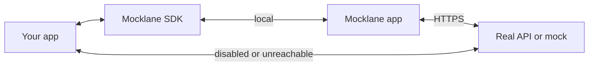

# Integration overview

The Mocklane SDK attaches to the HTTP client your app already uses. It does not replace the client or change your data layer. It rewrites each absolute `http(s)` URL to a gateway URL, and the Mocklane app decides what happens to the request.

If the Mocklane app is not reachable, the request goes to its original URL (fail-open), so the app still works when the Mocklane app is not running.

## Before you start

1. Run the **Mocklane app** and confirm the gateway is listening. The default address is `127.0.0.1:6625`; each platform guide shows how to use another host or port.
2. Send requests to **absolute** `http(s)` URLs. A relative path (`/v1/me`) has no origin to embed and is never rewritten.
3. Pick your platform and follow its guide.

Every SDK requires `enabled` explicitly, so interception stays off unless a debug build flag turns it on. A disabled SDK passes requests through unchanged.

## Choose your platform

Each guide covers dependencies, a minimal integration, verification in the Mocklane app, device connectivity, configuration, and platform caveats.

| Platform | HTTP client | Guide |
|----------|-------------|-------|
| Kotlin / Android / JVM | OkHttp, Ktor | [`integration/kotlin.md`](integration/kotlin.md) |
| Swift (iOS / macOS) | `URLSession` | [`integration/swift.md`](integration/swift.md) |
| Dart / Flutter | Dio | [`integration/dart.md`](integration/dart.md) |
| JavaScript / TypeScript | `fetch` | [`integration/javascript.md`](integration/javascript.md) |

## What success looks like

| Action in the app | Traffic row | Mode |
|-------------------|-------------|------|
| `fetch` / `dio.get('https://…')` | `GET /https://host/path` | `FORWARD` (or `MOCK` / `BREAK` with a rule) |
| `Mocklane.log('…')` | `POST /__mocklane/v1/log` | `SDK_LOG` |
| Device metadata | Detail / source | `source_label` = device name |

## Common pitfalls

| Symptom | Cause |
|---------|-------|
| No Traffic at all | The Mocklane app is not listening on the configured port, or the SDK is not enabled |
| Traffic empty but the API works | Fail-open: the Mocklane app is down or unreachable, so the original URL was used |
| A relative URL never appears | Only absolute `http(s)://…` URLs are rewritten |
| Phone works but nothing is captured | The phone's `127.0.0.1` is not your computer; use Connect Android / Connect iOS |
| `SDK_LOG` missing | The Mocklane app must support `POST /__mocklane/v1/log` |

## Logging and privacy

`Mocklane.log()` sends the message to the gateway, and the Mocklane app stores captured traffic. Request and response bodies are never redacted. Log messages are filtered on a best-effort basis by the JavaScript, Dart, and Swift SDKs. Only a valid JSON message is scanned, and only a fixed key list is replaced. The Kotlin SDK sends messages as-is. Each platform guide lists the exact keys.

The gateway is plain HTTP without authentication. The `host` setting must stay on loopback (`127.0.0.1`); pointing it at a LAN address sends captured credentials to everyone on that network.
