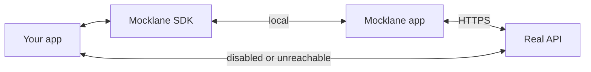

# mocklane (Dart / Flutter)

The Dart SDK works with the Mocklane app to capture your app's HTTP traffic in debug builds. It attaches a Dio interceptor and sends absolute `http(s)` requests through the Mocklane app. Every request and response appears in its Traffic view, where you can inspect, mock, rewrite, and debug them.



If the Mocklane app is not reachable, requests fail open to their original URL.

Requirements: Dart 3.3 or later and Dio 5.7 or later.

## Install

```bash
dart pub add mocklane       # or: flutter pub add mocklane
```

## Quick start

Install Mocklane into the Dio client your app already uses:

```dart
import 'package:dio/dio.dart';
import 'package:flutter/foundation.dart';
import 'package:mocklane/mocklane.dart';

final dio = Dio(); // your app's existing HTTP client

void main() {
  Mocklane.install(dio: dio, enabled: kDebugMode);
  runApp(const MyApp());
}
```

If the app has no Dio client yet, let Mocklane create and own one:

```dart
Mocklane.install(enabled: true);

final res = await Mocklane.dio.get('https://api.example.com/v1/me');
```

To attach the same interceptor to additional Dio instances, insert it into each client after `install()`:

```dart
otherDio.interceptors.insert(0, Mocklane.interceptor);
```

Full setup, device connectivity, and caveats: [`docs/integration/dart.md`](../../docs/integration/dart.md).

## API

| Member | Description |
|--------|-------------|
| `Mocklane.install({...})` | Installs the interceptor. No-op unless `enabled` is `true`; validates the config before stopping an active installation. |
| `Mocklane.uninstall()` | Removes the interceptor from the client it was installed on and releases the SDK's transports. |
| `Mocklane.log(message, {level, tag})` | Sends a structured message to `POST /__mocklane/v1/log`. Never throws into the app. |
| `Mocklane.dio` | The shared client created by `install()` when no `dio` was passed. Throws a `StateError` before `install()`. |
| `Mocklane.interceptor` | The installed interceptor, for attaching to other `Dio` instances. Throws a `StateError` before `install()`. |
| `Mocklane.isActive` | `true` while an installation is active. |

`level` is one of `debug`, `info`, `warn`, or `error` (default `info`).

## Options

| Option | Default | Meaning |
|--------|---------|---------|
| `enabled` | — (required) | Pass your build flag; `false` makes `install()` a no-op |
| `host` | `127.0.0.1` | Gateway host |
| `port` | `6625` | Gateway port |
| `failOpen` | `true` | Unreachable gateway → original request; `false` → reject |
| `probeTimeout` | `150ms` | Reachability-probe timeout |
| `device` | platform default | Device labels in Traffic |

Device labels default from the platform (`Platform.operatingSystem`, plus the hostname on desktop). Each field can be overridden:

```dart
Mocklane.install(
  enabled: kDebugMode,
  device: const DeviceMetadata(deviceName: 'my-app', appVersion: '1.2.3'),
);
```

Config is validated before anything is torn down: a blank host, a port outside 1–65535, or a non-positive probe timeout throws from `Mocklane.install()` without stopping an active installation.

## Devices

On Android and physical iOS devices, `127.0.0.1` refers to the device itself. In the Mocklane app, run **Connect Android** or **Connect iOS** once; see [`docs/integration/dart.md`](../../docs/integration/dart.md) for details.

## Cookie managers

Dio cookie managers key cookies by request URL. The SDK inserts its interceptor first and rewrites the URL to the gateway host before the cookie manager runs, so cookies are stored under `127.0.0.1:6625` rather than your origin. Auth that relies on origin-scoped cookies may behave differently while interception is on.

## Log masking

`Mocklane.log` messages are sent to the Mocklane app. Masking is best-effort and applies only to the message. A message is scanned only when it is valid JSON, and only the keys `password`, `token`, `access_token`, `refresh_token`, `id_token`, `secret`, `client_secret`, `api_key`, `session`, and `session_id` are replaced. Tag and free text are not scanned. Request and response bodies are never redacted.

## License

MIT — see [LICENSE](LICENSE).
