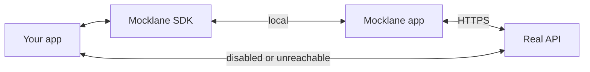

# mocklane-sdk

The JavaScript SDK works with the Mocklane app to capture your app's HTTP traffic in debug builds. It wraps the global `fetch` function and sends absolute `http(s)` requests through the Mocklane app. Every request and response appears in its Traffic view, where you can inspect, mock, rewrite, and debug them.



If the Mocklane app is not reachable, requests fail open to their original URL.

Requirements: ESM, Node.js 18 or later, or a browser with `fetch`.

## Install

```bash
npm i -D mocklane-sdk
```

## Quick start

```ts
import { Mocklane } from 'mocklane-sdk';

// Enable from your build flag; enabled is required.
if (import.meta.env.DEV) {
  Mocklane.install({ enabled: true });
}
```

Then call `fetch` as before. String, `URL`, and `Request` inputs are supported; a `Request` keeps its method, body, and headers.

Full setup, verification, and platform caveats: [`docs/integration/javascript.md`](../../docs/integration/javascript.md).

## API

| Member | Description |
|--------|-------------|
| `Mocklane.install(options)` | Installs the `fetch` hook. No-op unless `options.enabled` is `true`. Calling it again replaces the previous installation, and invalid options throw. |
| `Mocklane.uninstall()` | Removes the hook. Safe to call when interception is not running. |
| `Mocklane.log(message, level?, tag?)` | Sends a structured message to `POST /__mocklane/v1/log`. Never throws into the app. |
| `Mocklane.isActive()` | `true` while the hook is installed. |

`level` is one of `debug`, `info`, `warn`, or `error` (default `info`).

## Options

| Option | Default | Meaning |
|--------|---------|---------|
| `enabled` | — (required) | Pass your build flag; `false` makes `install()` a no-op |
| `host` | `127.0.0.1` | Gateway host |
| `port` | `6625` | Gateway port |
| `failOpen` | `true` | Unreachable gateway → original request; `false` → throw |
| `probeTimeoutMs` | `150` | Reachability-probe timeout |
| `device` | platform default | Device labels in Traffic |

Device labels default from the runtime: `os` is `web` in browsers (the device id persists in `localStorage` under `mocklane.deviceId`) and `node` elsewhere. Each field can be overridden:

```ts
Mocklane.install({
  enabled: true,
  device: { deviceName: 'my-app', appVersion: '1.2.3' },
});
```

Config is validated at `install()`: a blank host, a port outside 1–65535, or a non-positive probe timeout throws.

## Log masking

`Mocklane.log` messages are sent to the Mocklane app. Masking is best-effort and applies only to the message. A message is scanned only when it is valid JSON, and only the keys `password`, `token`, `access_token`, `refresh_token`, `id_token`, `secret`, `client_secret`, `api_key`, `session`, and `session_id` are replaced. Tag and free text are not scanned. Request and response bodies are never redacted.

## Limitations

- Only the global `fetch` is wrapped. Clients built on axios, `XMLHttpRequest`, or another transport are not covered.
- In a browser, the URL is rewritten before the browser attaches cookies, so `Cookie`/`Set-Cookie` handling sees the gateway host instead of your origin.

## Source layout

| Module | Responsibility |
|--------|----------------|
| `config` | Options and defaults |
| `rewrite` | Origin-prefixed gateway URL |
| `transport` | Reachability probe |
| `interceptor` | `fetch` hook |
| `masking` | Secret redaction for log messages |
| `logger` | `Mocklane.log` → `POST /__mocklane/v1/log` |
| `mocklane` | Public facade and composition |

## License

MIT — see [LICENSE](LICENSE).
