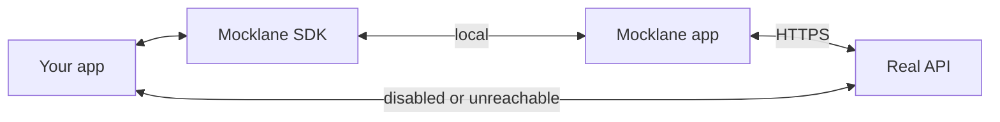

# mocklane (Kotlin)

The Kotlin SDK works with the Mocklane app to capture your app's HTTP traffic in debug builds. It attaches to the HTTP client you already use and sends absolute `http(s)` requests through the Mocklane app. Every request and response appears in its Traffic view, where you can inspect, mock, rewrite, and debug them.



If the Mocklane app is not reachable, requests fail open to their original URL. The host app turns interception on with `BuildConfig.DEBUG`.

Requirements: JDK 17. The SDK does not use `java.time`, so it does not require a higher `minSdk` or core-library desugaring.

## Modules

One adapter per HTTP client. Add only the artifact for the client you use:

| Module | Public entry point | Use when |
|--------|--------------------|----------|
| `mocklane-okhttp` | `MocklaneOkHttp.install(...)` | OkHttp / Retrofit |
| `mocklane-ktor` | `MocklaneKtor` | Ktor client (any engine) |

All adapters share the same config, log runtime, device labels, and rewrite rules. An app that uses both OkHttp and Ktor adds both adapter artifacts.

Adapters rewrite the URL and add device headers only. Request and response bodies are passed through untouched, so streaming and large uploads behave as they do without Mocklane.

## Install

```kotlin
// app/build.gradle.kts — OkHttp / Retrofit apps
debugImplementation("io.github.mocklane:mocklane-okhttp:0.1.1")

// Ktor apps
debugImplementation("io.github.mocklane:mocklane-ktor:0.1.1")
```

One adapter line is enough. The artifacts are published on Maven Central, so you need no extra repository or authentication.

Full setup, Android cleartext configuration, and device connectivity: [`docs/integration/kotlin.md`](../../docs/integration/kotlin.md).

## OkHttp / Retrofit

`MocklaneOkHttp.install` returns a new client built from the one you pass in. Use the returned client for every API call:

```kotlin
// `builder` holds your existing OkHttp configuration.
val existingClient = OkHttpClient.Builder()
  .addInterceptor(authInterceptor)
  .cookieJar(myCookieJar)
  .build()

val client = MocklaneOkHttp.install(existingClient, enabled = BuildConfig.DEBUG)
```

The client needs its interceptors, cache, and `CookieJar` configured before you call `install`. A `MocklaneConfig` sets per-client options:

```kotlin
val client = MocklaneOkHttp.install(
  existingClient,
  MocklaneConfig(
    port = 7000,
    enabled = BuildConfig.DEBUG,
    failOpen = false,
    device = DeviceMetadata(deviceName = "my-app"),
  ),
)
```

### What the adapter adds

- An **application interceptor** that rewrites absolute `http(s)` requests to the gateway URL and adds device labels. OkHttp selects the connection above a network interceptor, so the rewrite must be an application interceptor. It is appended after the client's existing interceptors, so auth and header interceptors you added earlier still run first.
- A **network interceptor** that keeps the client's `CookieJar` keyed to the embedded origin: `Set-Cookie` is parsed against the real origin, saved there, and stripped before OkHttp's own cookie handling sees the gateway URL.

The jar is captured at install time; a later `client.newBuilder().cookieJar(...)` is not scoped by Mocklane. Calling `install` twice on the same client keeps the first install.

The Mocklane app rewrites same-origin redirects to gateway-prefixed URLs, whether `Location` is absolute or relative. The hop stays captured and keeps `Authorization` and `Cookie` headers. If the client has an OkHttp `Cache`, responses are cached under the gateway URL (`http://127.0.0.1:6625/<origin>/<path>`) rather than the original URL; disable the cache while capturing if cache hits hide the traffic you expect.

## Ktor

A Ktor app uses `mocklane-ktor` instead of `mocklane-okhttp`. The plugin is engine-agnostic (CIO, OkHttp, Android, Darwin, `MockEngine`), and the app adds the Ktor engine it already uses:

```kotlin
val client = HttpClient {
  install(MocklaneKtor) {
    config = MocklaneConfig(
      port = 7000, // or host = "192.168.1.10"
      enabled = BuildConfig.DEBUG,
      device = DeviceMetadata(deviceName = "my-app"),
    )
  }
}
```

The plugin runs before the engine sends the request, so it sees the final URL, query, and body content type. WebSocket handshakes and gRPC bodies are skipped. The plugin must be installed after plugins that set request headers (for example `WebSockets`) so those headers are visible.

There is no cookie hook in a Ktor client plugin. `HttpCookies` keys cookies by the request URL, which is the gateway URL once the plugin has rewritten it, so cookies set through the gateway may be stored under `127.0.0.1:6625` and not shared with clients that skip Mocklane. Prefer `MocklaneOkHttp.install` for cookie-bound auth, or use a cookie manager that keys to the original URL.

## Configuration

| Field | Default | Meaning |
|-------|---------|---------|
| `host` | `127.0.0.1` | Gateway host |
| `port` | `6625` | Gateway port |
| `failOpen` | `true` | Unreachable gateway → original request; `false` → throw |
| `probeTimeoutMs` | `150` | Reachability-probe timeout |
| `device` | platform default | Device labels in Traffic |
| `enabled` | — (required) | Pass your build flag; `true` → intercept, `false` → pass-through |

A disabled adapter stays installed but is a pass-through. Capture requires an explicit `enabled = true`, so a release build cannot turn it on by omission. Invalid values are rejected by the `MocklaneConfig` constructor with an `IllegalArgumentException`.

`Mocklane.log()` uses the config of the most recently created **enabled** adapter. Creating a disabled adapter does not clear it, so one enabled client keeps logging while other clients stay pass-through; with no enabled adapter, logging is a no-op. Using the same config for all clients keeps gateway and device labels consistent.

The Mocklane app defaults to `127.0.0.1:6625`. With `adb reverse`, that address works for both the emulator and a physical device, and **Connect Android** sets the reverse for you. On Android 9 and later the host app needs a network-security exception for cleartext loopback; see [`docs/integration/kotlin.md`](../../docs/integration/kotlin.md).

WebSocket handshakes and gRPC calls pass through untouched until the Mocklane app supports them; ordinary HTTP traffic is unaffected.

## Logging

```kotlin
Mocklane.log("loaded profile", tag = "home")
```

Messages are sent as-is. The Kotlin/JVM SDK has no built-in JSON parser and does not add one, so mask secrets in your own code before logging. Request and response bodies are never redacted.

## Custom adapters

If a client has no official adapter, the app can depend on `mocklane-core` and keep the adapter thin. The shared pieces are available under `MocklaneInternalApi` (opt in with `@OptIn(MocklaneInternalApi::class)`):

```kotlin
@OptIn(MocklaneInternalApi::class)
class MyClientMocklane(config: MocklaneConfig) {
    private val resolved = Mocklane.bind(config)
    private val probe = HttpGatewayProbe(resolved)

    fun rewriteOrPass(url: String, headers: Map<String, String>, contentType: String?): String? {
        if (!resolved.enabled) return null
        if (UnsupportedProtocols.shouldSkip(headers["Upgrade"]?.let(::listOf).orEmpty(), contentType)) return null
        if (!probe.isReachable()) {
            if (resolved.failOpen) return null
            throw java.io.IOException(
                "Mocklane gateway unreachable at ${resolved.host}:${resolved.port}",
            )
        }
        return Rewrite.toGateway(url, resolved.host, resolved.port)
    }
}
```

`DeviceHeaders.values(resolved.device)` attaches the same labels, and the adapter calls `Mocklane.log` for structured logs. The shared URL-rewrite cases live in [`../../fixtures/url-rewrite.json`](../../fixtures/url-rewrite.json).

## Development

In a local checkout, you can point the app at the package directories instead of Maven Central:

```kotlin
// settings.gradle.kts
include(":mocklane-core", ":mocklane-okhttp")
project(":mocklane-core").projectDir = file("/path/to/sdk/packages/kotlin/mocklane-core")
project(":mocklane-okhttp").projectDir = file("/path/to/sdk/packages/kotlin/mocklane-okhttp")

// app/build.gradle.kts
implementation(project(":mocklane-okhttp"))
```

A Ktor app uses `mocklane-ktor` in place of `mocklane-okhttp`. Runnable samples live in [`../../samples/`](../../samples/). The test suites run from the package root:

```bash
cd packages/kotlin
./gradlew test
```

This runs the core rewrite/config tests, the OkHttp MockWebServer tests, and the Ktor MockEngine tests.

## License

MIT — see [LICENSE](../../LICENSE).
