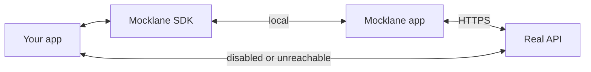

# mocklane (Swift)

The Swift SDK works with the Mocklane app to capture your app's HTTP traffic in debug builds. It installs a `URLProtocol` into a `URLSession` configuration and sends absolute `http(s)` requests through the Mocklane app. Every request and response appears in its Traffic view, where you can inspect, mock, rewrite, and debug them.



If the Mocklane app is not reachable, requests fail open to their original URL. The host app gates interception with `#if DEBUG`.

Requirements: iOS 15 or later, macOS 13 or later, Swift 5.9.

## Install

Add the package in Xcode (**File → Add Package Dependencies…**) or in `Package.swift`:

```swift
// Package.swift
dependencies: [
  .package(url: "https://github.com/mocklane/mocklane-sdk.git", from: "0.1.1"),
],
targets: [
  .target(name: "MyApp", dependencies: [.product(name: "Mocklane", package: "mocklane-sdk")]),
]
```

## Quick start

The SDK installs into the configuration your app already builds:

```swift
var configuration = URLSessionConfiguration.default // your app's configuration
#if DEBUG
configuration = Mocklane.install(configuration, enabled: true)
#endif
let session = URLSession(
  configuration: configuration,
  delegate: apiClientDelegate,        // your existing delegate
  delegateQueue: apiClientDelegateQueue
)
```

`install` copies the configuration and inserts `MocklaneURLProtocol` first, so the caller's object is unchanged and existing `protocolClasses`, delegates, cookies, and cache keep working. A disabled config is returned unchanged.

If the app does not own its session factory, `urlSession` creates one:

```swift
#if DEBUG
let session = Mocklane.urlSession(enabled: true)
#else
let session = URLSession(configuration: .default)
#endif
```

Both `urlSession` overloads also accept a `URLSessionDelegate` and delegate queue, like the `URLSession` initializer. The SDK never sees the delegate's callbacks.

Full setup — App Transport Security, physical devices, and per-client configuration: [`docs/integration/swift.md`](../../docs/integration/swift.md).

## Configuration

A `MocklaneConfig` sets any option beyond the boolean flag:

```swift
let config = MocklaneConfig(
  port: 7000,
  enabled: true,
  failOpen: false,
  device: DeviceMetadata(deviceName: "my-app")
)
configuration = Mocklane.install(configuration, config: config)
```

| Field | Default | Meaning |
|-------|---------|---------|
| `host` | `127.0.0.1` | Gateway host |
| `port` | `6625` | Gateway port |
| `failOpen` | `true` | Unreachable gateway → original request; `false` → fail |
| `probeTimeoutMs` | `150` | Reachability-probe timeout |
| `device` | platform default | Labels in Traffic |
| `enabled` | — (required) | Pass your build flag; `true` → intercept, `false` → pass-through |

Invalid values never trap. A blank or malformed `host`, an out-of-range `port`, or a non-positive `probeTimeoutMs` falls back to the default and is reported in `config.validationError`; a bad host or port also forces `enabled = false`, so a typo cannot silently turn capture on. Bare IPv6 hosts are bracketed (`::1` → `[::1]`).

The app should create the session once and reuse it. A disabled config is a no-op: it neither clears the log runtime of an enabled session nor stops the USB bridge.

`Mocklane.log()` uses the config of the most recently created enabled session. If no session has ever been enabled, logging is a no-op; creating a disabled session does not change it. Using the same config for all sessions keeps gateway and device labels consistent.

The Mocklane app defaults to `127.0.0.1:6625`. On the Simulator or macOS that is already the local gateway. On a physical iOS device, Mocklane starts the embedded USB mux when an enabled session is created on a loopback host. The bridge listens on loopback only, so it is not reachable from the local network. It has no authentication, so treat it as a debug-only trust boundary and never enable interception in a release build.

## Behavior

- **Streaming** — response bodies are forwarded chunk by chunk, so SSE and long-poll responses reach the app as they arrive. Cancelling the task stops the forwarded request.
- **Cookies** — a custom `URLProtocol` bypasses URLSession's cookie handling, so the SDK mirrors it: it attaches `Cookie` from your configuration's `HTTPCookieStorage` and stores `Set-Cookie` against the original origin.
- **Redirects** — followed inside the forwarding session and captured. Relative and gateway-prefixed `Location` values resolve against the original origin, and same-origin hops keep `Authorization` and `Cookie`; cross-origin hops drop them the way `URLSession` does.
- **Uploads** — The Mocklane app buffers request bodies up to 64 MiB (`GATEWAY_REQUEST_BODY_MAX`); larger uploads fail at the gateway. Response streaming is unaffected.
- **Background sessions** — not supported. iOS rejects custom `URLProtocol` classes in background configurations, so enabling interception on a configuration with an `identifier` traps. Pass-through is fine.
- **WebSocket and gRPC** — handshakes and gRPC calls pass through untouched until the Mocklane app supports them; ordinary HTTP traffic is unaffected.

## Logging

```swift
Mocklane.log("loaded profile", tag: "home")
```

Log messages are filtered on a best-effort basis. A message is scanned only when it is valid JSON, and only the keys `password`, `token`, `access_token`, `refresh_token`, `id_token`, `secret`, `client_secret`, `api_key`, `session`, and `session_id` are replaced. Tag and free text are not scanned. Request and response bodies are never redacted.

## Development

```bash
cd packages/swift
swift test
```

Runnable samples: [`../../samples/ios/`](../../samples/ios/) (SwiftUI) and [`../../samples/swift-cli/`](../../samples/swift-cli/) (macOS CLI).

## Architecture

App code uses only `Mocklane`, `MocklaneConfig`, `DeviceMetadata`, and `LogLevel`. Everything else is internal to the package.

| Type | Responsibility |
|------|----------------|
| `Mocklane` | Public facade: `urlSession`, `install`, `log`, `rewrite` |
| `MocklaneConfig` | Public runtime options and validation |
| `DeviceMetadata` | Public device labels |
| `LogLevel` | Public log level enum |
| `MocklaneURLProtocol` | URLSession hook: probes, rewrites, streams back |
| `Forwarder` | Long-lived forwarding session per runtime (streaming, redirects, cookies, cancellation) |
| `MocklaneRewrite` | Origin-prefixed gateway URL |
| `GatewayProbe` | Reachability probe (URLSession) |
| `Logger` | `POST /__mocklane/v1/log` |
| `Masking` | Redaction helpers applied to log messages |

## License

MIT — see [LICENSE](../../LICENSE).
